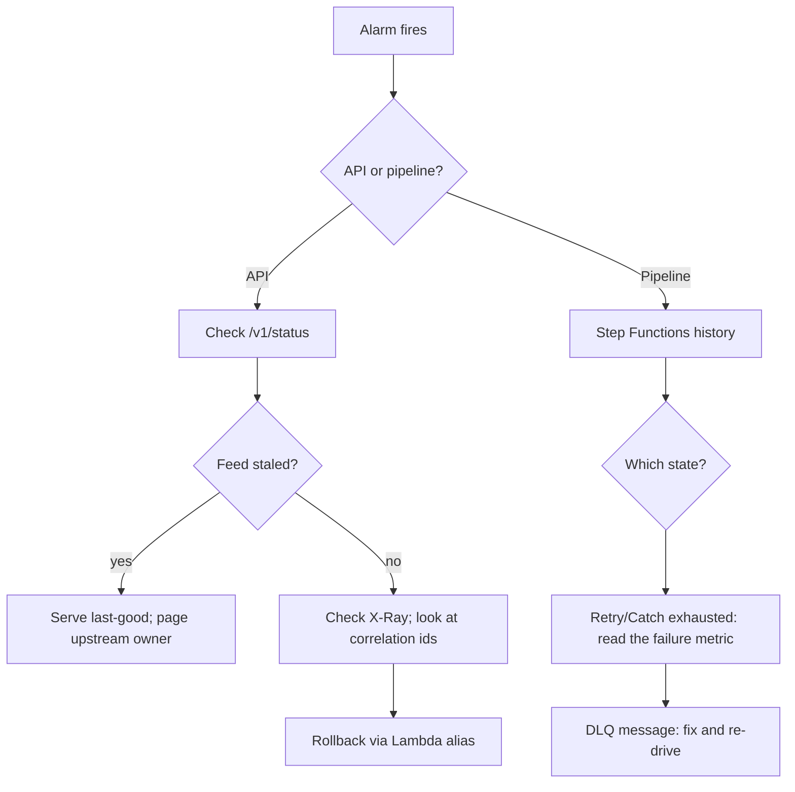

# Incident response

## 1. Classify

| Alarm | First place to look |
|---|---|
| API 5xx spike | CloudWatch logs filtered by `correlation_id`; X-Ray segments |
| Pipeline failure | Step Functions execution history → the state that failed |
| Stale feeds | `/v1/status` per-feed `ok` + `age_seconds` |
| DLQ depth > 1 | SQS messages → the execution's error |
| Lambda throttles | API Gateway usage plan + concurrency settings |

## 2. Decision flow

## 3. Fix

- Store/upstream outage → verify last-good values are being served (`stale: true` in responses); reassure users via the status page, not silence.
- Deploy regression → rollback the Lambda alias (canary deployment makes this one command).
- Pipeline bug → fix, re-drive from the DLQ, then check the DLQ depth alarm clears.

## 4. After

- Add the alarm → diagnosis → fix path to `docs/RUNBOOK.md` if it was new.
- Add a regression test reproducing the failure.
- Note in `CHANGELOG.md`.
