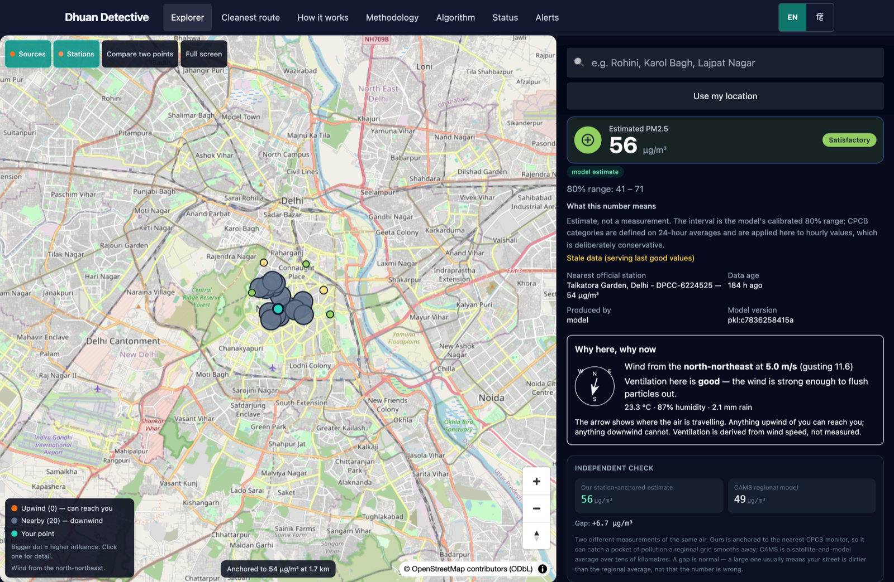
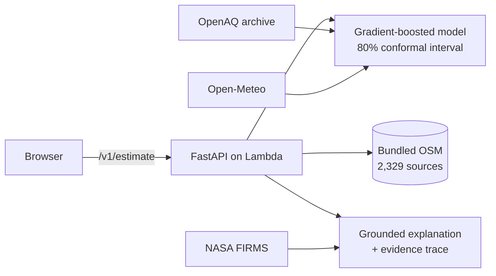

<div align="center">

# Dhuan Detective

**Why is the air bad on my street right now, and what should I do?**

Street-level PM2.5 for any point in Delhi-NCR — with the interval, the
evidence and the honest caveats attached.

[](https://github.com/FiscalMindset/aqi/actions/workflows/ci.yml)


[**Open the live app →**](https://vz7mjma8sj.execute-api.ap-south-1.amazonaws.com/staging/)

</div>

---

<div align="center">
<picture>
  
</picture>
<sub>Pick a point on the map. Every number on screen is an estimate with its interval, its data age and its model version beside it.</sub>
</div>

---

## What it does

For any point in Delhi-NCR:

| | |
|---|---|
| **Estimate** | Hourly PM2.5 with a calibrated 80% interval — never a bare number |
| **Attribute** | Ranked pollution sources upwind of you, from a bundled OpenStreetMap extract |
| **Explain** | A grounded narrative where every claim cites the evidence behind it |
| **Cross-check** | An independent CAMS reading beside ours, so disagreement is visible |
| **Compare** | Ranked real-road routes by exposure, not distance |



## Honest limitations

These are the real constraints, stated up front rather than buried:

- **CPCB categories are defined on 24-hour averages.** We apply them to hourly
  estimates. That is deliberately conservative and labelled as such on screen.
- **The interval covers model error, not sensor error.** A wrong monitor is
  still a wrong answer.
- **Source ranking is a transparent heuristic, not a causal model.** It tells
  you what is upwind, not what produced the molecules at your door.
- **The station archive lags real time.** Live serving falls back to the free
  OpenAQ public archive, which runs days behind. Staleness is always shown
  rather than hidden.
- **Email alerts have not yet delivered end to end.** The chain is largely
  repaired — see [Alert status](#alert-status) — but do not rely on it yet.
- **Measured accuracy is weaker for a station it has never seen** than for one it
  has. That row is shown in amber wherever it appears.

## Quickstart

```bash
# 1. containers: OpenSearch + LocalStack  (requires Docker)
make dev

# 2. seed real OpenStreetMap sources into OpenSearch
make seed-sources

# 3. backend  (terminal 1)
cd backend && uv run uvicorn dhuan.api.app:app --port 8000

# 4. web app  (terminal 2)
cd frontend && npm ci && npm run dev
```

Open **http://localhost:5173**. There is no demo mode and no fake data: with no
credentials configured the app serves the keyless OpenAQ archive, the keyless
Open-Meteo forecast, and the bundled source extract, and it says how old each
of those is.

## Commands

| Command | Does |
|---|---|
| `make dev` | OpenSearch + LocalStack + backend + frontend |
| `make test` | Every test layer |
| `make lint` | ruff + eslint |
| `make types` | mypy `--strict` + tsc |
| `make train` | Reproducible retrain; snapshot hash recorded |
| `make docs` | MkDocs site, built strictly |
| `make verify` | lint + types + tests + docs, one gate |

## The model

| | |
|---|---|
| Algorithm | `HistGradientBoostingRegressor`, quantile loss at p10/p50/p90 |
| Target | The **residual** `pm25(t) − pm25(t−1h)`, so "repeat the last reading" is the thing it must beat |
| Training rows | 591,372 |
| Stations | 73 across Delhi-NCR |
| Features | 27 |
| MAE (future hours) | 11.2 µg/m³ |
| MAE (unseen station) | 10.7 µg/m³ |
| Interval | Conformal, calibrated to 80% coverage |

Every retrain is **kept, not overwritten**, and every version is comparable on
the same holdout — so a model that got worse is visible instead of silent. See
`docs/training_data.md` for the full dataset description and
`docs/MODEL_CARD.md` for the measured results.

## Alert status

Email alerts are the one thing here that is **not** working end to end, and
the history is worth stating plainly: the pipeline could not complete at all
until recently (a task exceeded the Step Functions 256 KB result limit on every
run), the delivery topic was never wired into the Lambda, and the alert was
being judged against a coarser number than the one shown on screen. Each of
those is fixed. The remaining blocker is that the per-cell upgrade to the
displayed estimate fails on a nested event loop, so **no alert has ever been
delivered**. Treat the form as unverified until that is closed.

## Layout

```
backend/    FastAPI, model, agents, pipeline, ingest clients, stores
frontend/   React + TypeScript + MapLibre PWA
infra/      SAM template + Step Functions definition
docs/       MkDocs site, ADRs, model card, training data
scripts/    verification, deploy, smoke, teardown
```

## Documentation

| Document | Contains |
|---|---|
| [training_data.md](docs/training_data.md) | Every dataset figure, all 73 stations, provenance |
| [MODEL_CARD.md](docs/MODEL_CARD.md) | Measured accuracy, baselines, limits |
| [ARCHITECTURE.md](docs/ARCHITECTURE.md) | System flow and ER diagrams |
| [ALGORITHM.md](docs/ALGORITHM.md) | H3 grid, cone geometry, scoring |
| [DATA_SOURCES.md](docs/DATA_SOURCES.md) | Every feed, its licence and rate limit |
| [RULES.md](docs/RULES.md) | The engineering rules this repo enforces |

---

<div align="center">
<sub>
MIT licensed. Data: OpenAQ (CC BY 4.0) · © OpenStreetMap contributors (ODbL) ·
Open-Meteo / CAMS · NASA FIRMS.
</sub>
</div>