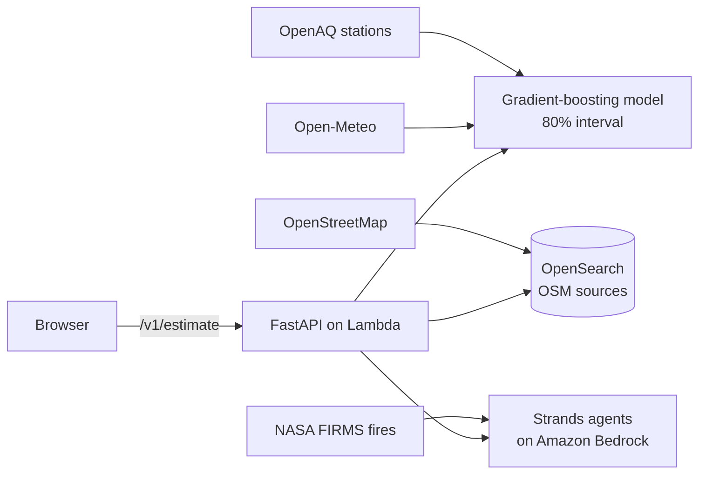

# Dhuan Detective

**Why is the air bad on my street right now, and what should I do?**

Dhuan Detective estimates street-level PM2.5 for any point in Delhi-NCR, finds the likely pollution sources upwind, explains the causes with visible evidence from an AI agent, and gives tailored advice for parents, delivery riders and outdoor workers.

## Live app

**https://vz7mjma8sj.execute-api.ap-south-1.amazonaws.com/staging/**

Deployed on AWS (ap-south-1) from the `main` branch. Try it: pick a point on the
map, read the estimate with its 80% interval, then read the cited explanation
and open any paragraph's evidence. No API key is needed to use it — station
readings come from the OpenAQ public archive and pollution sources from a
bundled OpenStreetMap extract.

[](https://github.com/FiscalMindset/aqi/actions/workflows/ci.yml)


---

## What it does



For a point in Delhi-NCR:

1. **Estimate** — hourly PM2.5 on H3 res-8 cells with a calibrated 80% interval (never a bare number).
2. **Attribute** — ranked, upwind pollution-source candidates from OpenStreetMap via OpenSearch geo queries.
3. **Explain** — a Strands agent on Amazon Bedrock shows its tool-call trace; every claim cites evidence.
4. **Act** — persona advice, alerts with hysteresis, and a cleanest-route comparison.

Every number on screen is an **estimate, not a measurement**, with its data age and model version beside it.

## Quickstart (local, no AWS account needed)

```bash
# 1. start the containers (OpenSearch + LocalStack)
make dev

# 2. seed real OpenStreetMap sources into OpenSearch
make seed-sources

# 3. run the backend (demo mode = recorded real data, banner shown)
cd backend && DEMO_MODE=1 uv run uvicorn dhuan.api.app:app --port 8000

# 4. run the web app (another terminal)
cd frontend && npm ci && npm run dev
```

Open http://localhost:5173 — you should see the explorer with the demo-data banner.

## Commands

| Command | What it does |
|---|---|
| `make dev` | Start OpenSearch + LocalStack + backend + frontend |
| `make test` | All test layers (unit, integration, model, agent evals) |
| `make lint` / `make types` | ruff + eslint; mypy --strict + tsc |
| `make train` | Reproducible model training (snapshot hash recorded) |
| `make docs` | Build the MkDocs documentation site strictly |
| `make verify` | lint + types + tests + docs, one gate |

## Project layout

```
backend/    FastAPI, model, agents, pipeline, ingest clients, stores
frontend/   React + TypeScript + MapLibre PWA
infra/      SAM template + Step Functions definition
docs/       MkDocs Material site (architecture, model card, ADRs)
scripts/    seeding, backfill, smoke, teardown
fixtures/   recorded demo data (never served as live)
```

## Honest limitations

- CPCB AQI categories are defined on **24-hour** averages; we apply them to hourly estimates (conservative, labelled).
- The 80% interval covers **model** error, not sensor error.
- Source ranking is a transparent heuristic, not a causal model.
- The model was trained on OpenAQ's public archive (3 Indian metros); see `docs/MODEL_CARD.md` for real metrics and the nearest-station baseline comparison.

## Documentation

| Document | Contents |
|---|---|
| [docs/ARCHITECTURE.md](docs/ARCHITECTURE.md) | System flow, sequence and ER diagrams |
| [docs/AWS.md](docs/AWS.md) | Every AWS service and the real job it does |
| [docs/MODEL.md](docs/MODEL.md) | Method, validation, honest limits |
| [docs/ALGORITHM.md](docs/ALGORITHM.md) | The algorithms: H3 grid, cone math, scoring |
| [docs/DATA_COLLECTION.md](docs/DATA_COLLECTION.md) | How real data is fetched and verified |
| [docs/RULES.md](docs/RULES.md) | Engineering rules this repo enforces |
| [explain.md](explain.md) | The whole story for interviews |

## License

MIT. Data attribution: OpenAQ (CC BY 4.0), © OpenStreetMap contributors (ODbL), Open-Meteo, NASA FIRMS.
