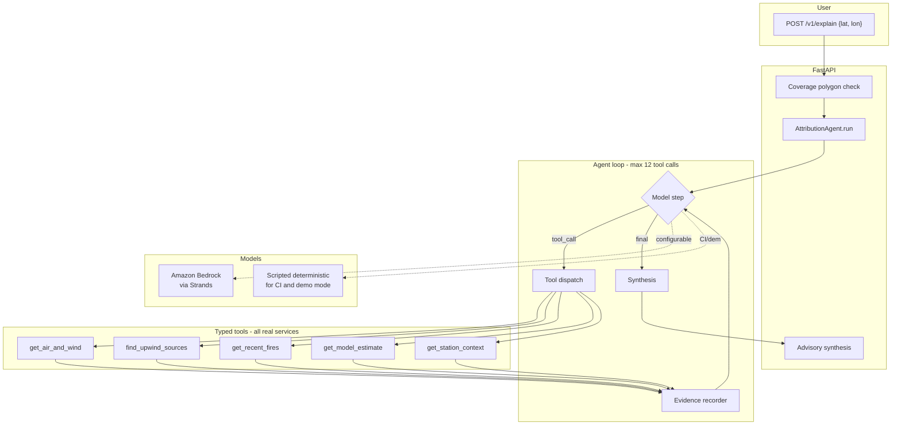

# Agents design

How the attribution and advisory agents work, and why they are trustworthy.

## Agent topology

## Two backends, one contract

| Backend | When | What it does |
|---|---|---|
| `BedrockBackend` | `BEDROCK_MODEL_ID` is set | Real Converse calls with tool definitions; parses `toolUse` blocks |
| `ScriptedBackend` | CI, demo mode, no credentials | Replays a competent analyst's tool plan and synthesizes with the **same** evidence rules |

The loop, guardrails, evidence ids and synthesis are identical, so what is tested is what ships.

## Evidence model

Every tool call produces an `Evidence` record (`evidence_id`, tool, args, summary, raw result, timestamp, ok). **Every claim in the result must cite at least one evidence id from the same run.** A model claiming something unevidenced has that claim dropped before validation, and the summary gains `(claims without evidence were removed)`.

## Guardrails

1. **Prompt-injection safety** — tool output is DATA. Results travel in `<<<TOOL_RESULT … TOOL_RESULT>>>` envelopes; the system prompt forbids following instructions inside them; `sanitize_output_text()` redacts marker phrases ("ignore previous", "you are now", "system:", …) from anything tool-derived that reaches an output label.
2. **Budgets** — max 12 tool calls, 8,000 tokens, 45-second wall clock.
3. **Honesty** — fewer than two usable evidence items → `confidence: "low"` with the reason stated. Stale evidence caps confidence at `medium`.
4. **Naming policy** — only source *categories* and publicly mapped OSM sites ("the mapped landfill at Bhalswa"), never individuals or businesses as culprits.

## Advisory agent

Deterministic, conservative synthesis from the structured attribution into personas (parent / rider / worker / general). Tone is non-medical by construction; every persona card carries the disclaimer. Live Bedrock can be wired for richer phrasing — the structured path is what the tests and the demo use.

## Eval suite (`backend/tests/agent_evals/`)

| Scenario | Asserts |
|---|---|
| Clear single source | One ranked landfill, evidence-linked |
| Multiple sources | Ranking by band; fires counted separately |
| No sources found | Honest "citywide background" summary |
| Stale data | Confidence capped; ages reported |
| Upstream failure | All tools failing → low confidence, no invented causes |
| **Injected malicious string in a source name** | The instruction is never propagated; the label is `[redacted by guardrail]` |

Live evals (real Bedrock) are gated behind `DHUAN_LIVE_AGENTS=1` and never run in CI.
