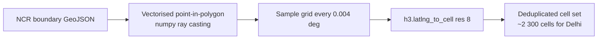
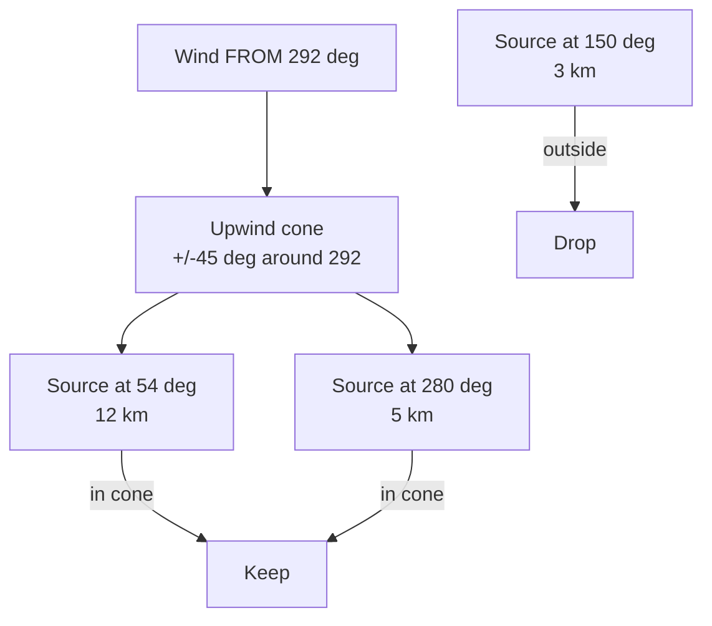
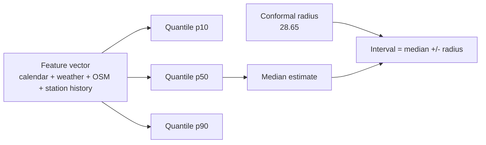
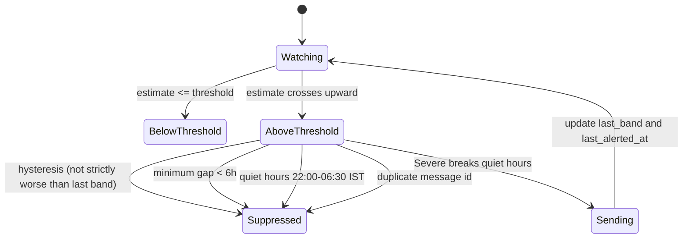

# Algorithms

The maths behind Dhuan Detective, in the order data flows.

## 1. H3 grid

Delhi-NCR is covered with **H3 resolution-8** cells (~0.74 km² average area). The NCR boundary polygons are real OpenStreetMap district relations (fetched via Overpass, simplified, with provenance recorded in `backend/src/dhuan/geo/ncr_boundary.geojson`).



The cell set is **deterministic** given the boundary file and resolution, so tests can pin exact counts (`tests/unit/test_boundary_grid.py`).

## 2. Great-circle and bearing math

Pure functions in `backend/src/dhuan/geo/geo_math.py`:

- **Distance** — haversine with the IUGG mean Earth radius (6371.0088 km).
- **Initial bearing** — `atan2(sin Δλ cos φ2, cos φ1 sin φ2 − sin φ1 cos φ2 cos Δλ)`, normalised with a float-safety guard that maps a modulo-360 result of exactly `360.0` back to `0.0`.
- **Angle difference** — smallest absolute difference between two bearings in `[0, 180]`.
- **Upwind cone** — meteorological wind is "wind FROM". A source is upwind of a target when the bearing from target to source is within ±45° of the wind-from direction:



All of these are property-tested with Hypothesis, including 0/360° wrap-around.

## 3. Influence score (transparent heuristic)

```
influence = type_weight × size_factor × distance_decay × wind_alignment
```

| Factor | Rule |
|---|---|
| `type_weight` | landfill 1.00, brick kiln 0.85, industrial 0.80, construction 0.55, junction 0.35, other 0.20 |
| `size_factor` | log₁₀(area m²) scaled to [0.30, 1.00]; unknown area → 0.55 |
| `distance_decay` | exp(−d / 6 km) |
| `wind_alignment` | 1.0 inside the cone, cosine falloff to 0.10 beyond it |

**This is a heuristic for ranking candidates, not a causal model.** It is documented as such in the model card and the UI. Code: `backend/src/dhuan/geo/scoring.py`.

## 4. Prediction and the 80% interval

Three quantile gradient-boosting models (p10 / p50 / p90) plus a **split-conformal radius** calibrated so the served interval covers ~80% of the temporal holdout (measured, asserted in `tests/model/test_model.py`).



## 5. Alert rules



Severe always breaks quiet hours; other bands wait until 06:30 IST. Messages state the estimate, its interval, the likely-cause category and an unsubscribe link.
