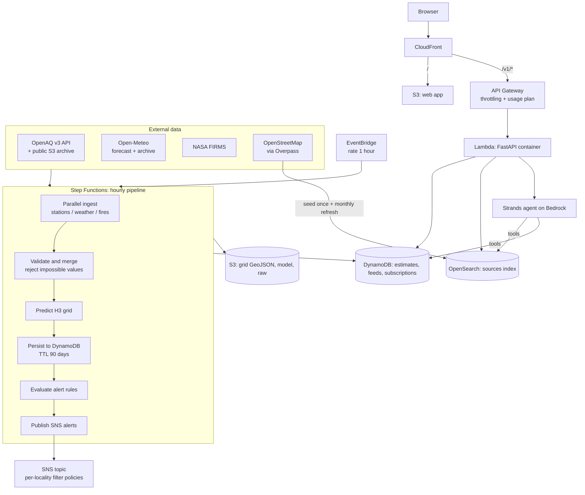
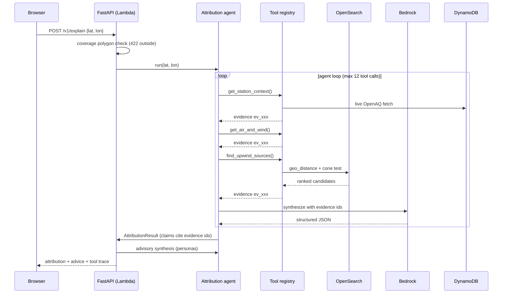
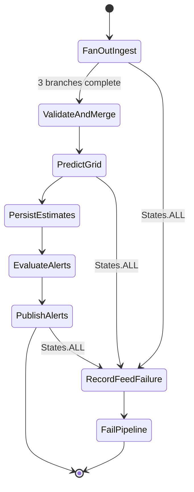

# Architecture

Dhuan Detective turns weather, station, fire and map data into street-level PM2.5 estimates with attributed, evidence-linked explanations.

## System flow



## `/v1/explain` sequence



## Pipeline state machine



Every task state has `Retry` (exponential backoff, `FULL` jitter) and a `Catch` that records feed status and emits a metric — never a silent failure.

## Data model (ER)

```mermaid
erDiagram
    ESTIMATES ||--|{ CELL : "hash key cell#<h3>"
    ESTIMATES {
        string pk "cell#<h3>"
        string sk "ts#<iso>"
        float pm25_low
        float pm25_mid
        float pm25_high
        string model_version
        number ttl "90 days"
    }
    FEEDS {
        string pk "feed=<name>"
        bool ok
        string last_success_at
        string last_error
        int records_last_run
    }
    SUBSCRIPTIONS {
        string pk "sub#<sha256[:16]>"
        string email
        string locality "GSI hash key"
        float lat
        float lon
        string threshold_category
        bool confirmed
        string pending_token
        string last_band
        string last_alerted_at
    }
    SOURCES {
        string osm_id
        keyword type
        text name
        geo_point location
        float area_m2
        object source_tags
        date last_seen
    }
```

## Design decisions

Every major decision is recorded as an ADR in [docs/adr/](adr/): the 8% coverage threshold, the estimate-serving rule (better of model vs nearest-station baseline), the agent backend abstraction, H3 resolution 8, and more.
