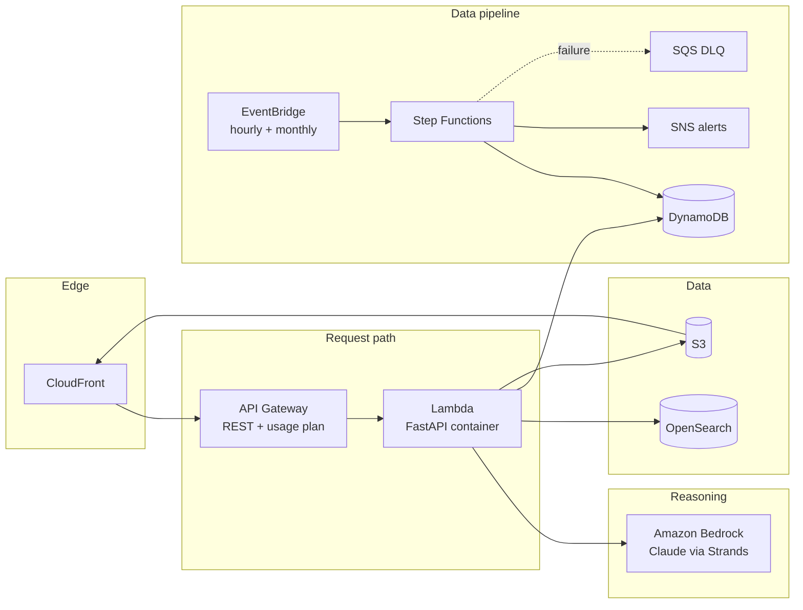

# AWS services and the real job each one does

No decorative AWS usage: every service below does work the product cannot do without it.

## Compute and API

| Service | The real job | Where in code |
|---|---|---|
| **Amazon Bedrock** | Model behind the attribution agent. Model id comes from `BEDROCK_MODEL_ID`, never hardcoded | `backend/src/dhuan/agents/runtime.py` (`BedrockBackend`) |
| **Strands Agents SDK** | The agent loop: typed tools, evidence ids, guardrails | `backend/src/dhuan/agents/` |
| **Amazon OpenSearch** | Geo-indexed pollution-source database; `geo_distance` + upwind-cone queries | `backend/src/dhuan/store/opensearch.py` |
| **AWS Step Functions** | The hourly pipeline: parallel ingest → validate → predict → persist → alert, with retries, catch blocks, failure path | `infra/state-machine.asl.json` |
| **Amazon EventBridge** | `rate(1 hour)` pipeline schedule + `rate(30 days)` source refresh | `infra/template.yaml` |
| **Lambda + API Gateway** | One container image, several handlers; stage throttling and a usage plan (stricter limits on `/v1/explain`) | `backend/Dockerfile`, `infra/template.yaml` |
| **Amazon DynamoDB** | Estimates (TTL 90d), feed freshness, subscriptions (GSI on locality); on-demand + PITR | `backend/src/dhuan/store/dynamodb.py` |
| **Amazon S3** | Grid GeoJSON, model artifacts, raw archives, web app | `backend/src/dhuan/store/s3.py` |
| **Amazon CloudFront** | Serves the web app and routes `/v1/*` to the API | `infra/template.yaml` |
| **Amazon SNS** | Alert fan-out to email subscribers with per-locality filter policies | `backend/src/dhuan/alerts/alerts.py` |
| **Amazon SQS** | Dead-letter queue for failed pipeline executions + depth alarm | `infra/template.yaml` |
| **Amazon Location Service** | Map tiles (MapLibre) and route alternatives (`/v1/routes/compare`) | `frontend` (tiles), roadmap in routes |
| **SSM Parameter Store / Secrets Manager** | API keys and configuration (`OPENAQ_API_KEY`, `FIRMS_MAP_KEY`, …) | `.env.example` documents names only |
| **CloudWatch + X-Ray** | Structured logs with correlation id, EMF metrics, dashboards, alarms; tracing via Lambda Powertools | `backend/src/dhuan/core/` |

## Why serverless

A two-person team can run a global-quality hourly pipeline with no servers to patch, geo queries that SQL cannot do well, auditable retryable orchestration, and frontier reasoning without owning GPUs. Cost at demo scale is single-digit dollars per month (see `docs/COST.md`).

## Guardrails

- One IAM role per function with least-privilege statements (DynamoDB tables, one S3 bucket, one SNS topic, bedrock:InvokeModel).
- Canary deployment (`Canary10Percent5Minutes`) with automatic rollback on the API error alarm.
- Log retention set; DLQ depth and API 5xx alarms defined in the template.
