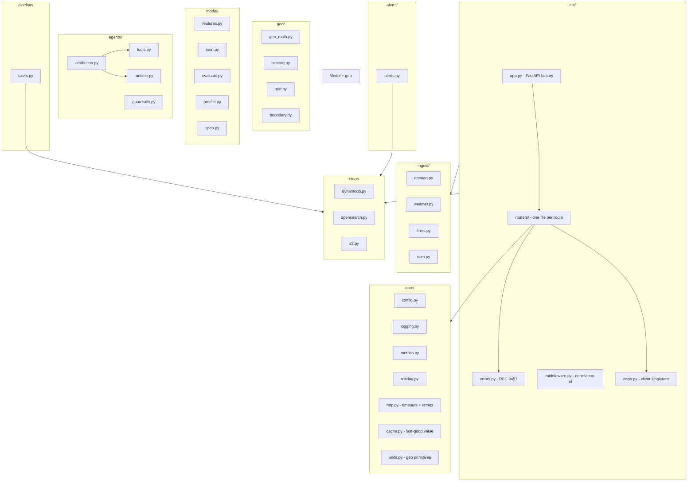

# Backend engineering

Everything inside `backend/`: layout, patterns, and the rules that keep it production-grade.

## Module map



## Route pattern (every route, no exceptions)

```
1. Pydantic request schema (src/dhuan/api/schemas.py)
2. Typed response model (src/dhuan/api/models.py) with OpenAPI examples
3. FastAPI router with Query/Path validation + Depends(get_settings)
4. Coverage/business guards raise typed Problem exceptions (RFC 9457)
5. Store/upstream failures become typed 503 problems, never unhandled 500s
6. Structured logs carry the correlation id; EMF metrics on every path
7. Unit tests (respx-mocked upstreams) + integration tests (containers)
   + contract coverage (Schemathesis)
```

Reference implementation: `src/dhuan/api/routers/estimate.py`.

## HTTP discipline

Every outbound call goes through `core/http.py`:

- `httpx.Timeout` with connect + read timeouts (never a naked timeout).
- `tenacity` retries with `wait_exponential_jitter` and `FULL` jitter.
- Retryable statuses: 408, 425, 429, 500, 502, 503, 504. Client errors (4xx other) raise immediately.
- Transport errors become `UpstreamError` with the source name — never a bare exception.
- Metrics: `UpstreamRequests`, `UpstreamRetries`, `UpstreamErrors`.

## Conventions

- **No `print`** — `get_logger`/`log_event` only; JSON lines with correlation ids.
- **No bare `except`** — `except Exception as exc:` with a log and a metric.
- **Clients are singletons** in `api/deps.py` with `reset_clients()` for tests.
- **Store types**: DynamoDB uses `Decimal` (float serialisation raises `TypeError`).
- **Lazy imports** where they keep cold starts small (pipeline handlers).
- **Typed everywhere**: `mypy --strict` clean on `src/`.

## Quality gates

```bash
cd backend
uv run ruff check src tests          # 50+ rule families
uv run mypy --strict src             # zero errors
uv run pytest tests/unit             # hermetic
uv run pytest tests/integration      # OpenSearch + LocalStack containers
uv run pytest tests/model            # leakage, coverage, baseline regression
uv run pytest tests/agent_evals      # 6 deterministic scenarios
uv run pytest tests/contract         # Schemathesis, zero unhandled 5xx
uv run pytest tests/ --cov=src/dhuan # 84.65% (threshold 84, documented)
```

Known measured numbers: **230 passing tests** (1 skipped without a trained artifact), 84.65% line coverage, ruff clean, mypy --strict clean.
