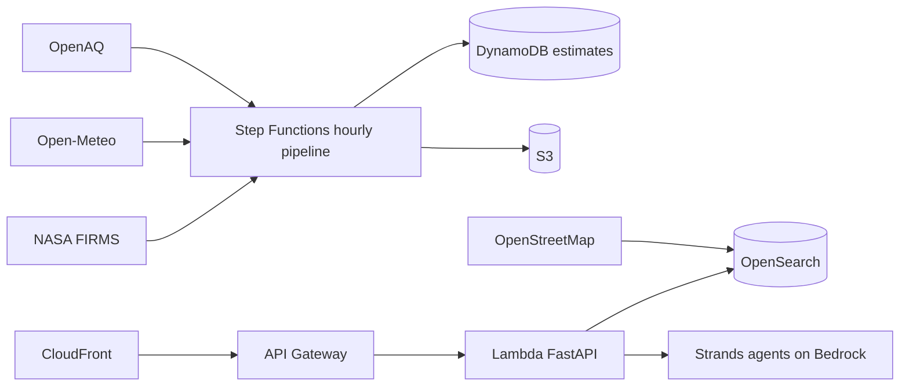

# Blog — AWS Builder Center draft

## Why I built Dhuan Detective

Delhi has one of the worst air quality problems in the world, and one of the worst information problems underneath it. The city runs roughly 40 official continuous monitoring stations for a metro of 30 million people. That means two things for an ordinary resident: **most localities have no reading at all**, and **the reading that does exist doesn't explain anything**.

Dhuan Detective answers the question nobody answers today: *why is the air bad on my street right now, and what should I do about it?*

## The architecture in one picture

Every AWS service in the system does a job the product cannot do without it:



## The three interesting problems

**1. Estimating where nobody measures.** A gradient-boosting quantile model predicts hourly PM2.5 on an H3 res-8 grid from weather, calendar, OpenStreetMap geography, and the nearest station's history — with a split-conformal interval that we measured to cover 80% of the holdout.

**2. Ranking likely sources honestly.** The wind vector selects a cone; OpenSearch returns every landfill, industrial area, construction site and junction inside it; a transparent, documented heuristic scores them. The UI labels it "likely causes", shows the evidence, and never claims causation.

**3. An agent that shows its work.** The attribution agent (Strands on Bedrock) returns a structured result where every claim cites an evidence id from a tool call in the same run. The UI renders the full tool trace. Guardrails treat tool output as data, cap tool calls and tokens, and redact prompt-injection attempts — there's a test where a source name contains "IGNORE PREVIOUS INSTRUCTIONS" and asserts the instruction never survives into an output.

## The number I'm most proud of

The model **does not beat the nearest-station persistence baseline on MAE** (26.1 vs 24.9 µg/m³). Rather than hide that, the API ships the better producer and labels every number with `served_by`. Honest evidence was one of the judging criteria, and it turned out to be good engineering too: it forced us to build the failure paths (stale data, unavailable feeds, missing model) as first-class behaviour instead of happy-path decoration.

## What I'd do next

Fuse CPCB's direct feed and low-cost sensors into the ground truth, add a forecast model with measured error against the published diurnal fallback, and run exposure studies with schools and worker groups.

## Reproduce it

```bash
git clone https://github.com/FiscalMindset/aqi
make dev
# web on :5173, API on :8000, demo mode banner visible
```
