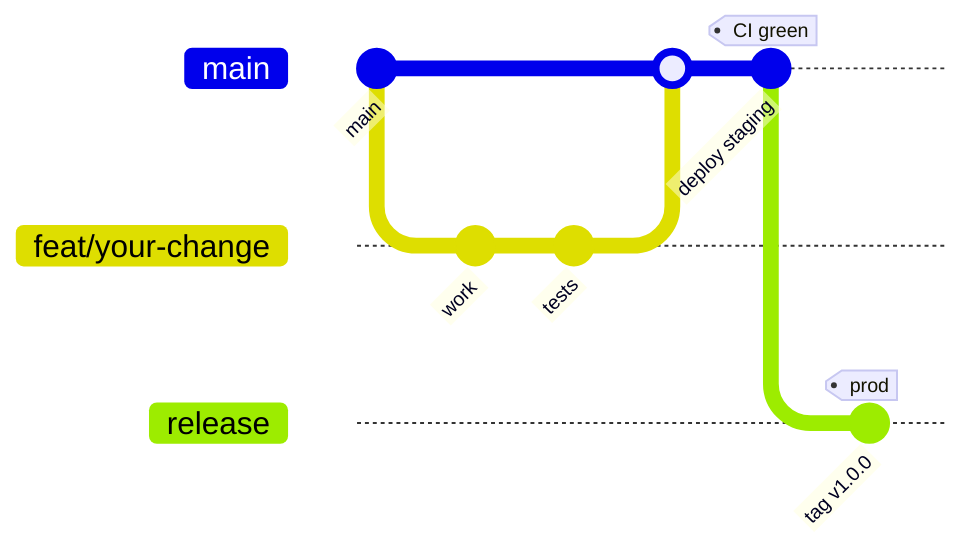

# Contributing

## Workflow



1. Branch: `feat/<short-name>` or `fix/<short-name>`.
2. Commit after **every meaningful step** with a Conventional Commit.
3. Open a PR; CI must be green (all 14 jobs are required).
4. Merge to `main` → staging deploys automatically.
5. Tag `vX.Y.Z` → production after manual approval.

## Commit style

```
feat(api): add /v1/routes/compare with exposure ranking
fix(alerts): hysteresis blocked Severe escalations
test(model): add leakage test for station_lag1
docs(architecture): refresh the sequence diagram
```

Body: what changed, why, and the commands you ran.

## Branch protection (documented as repo settings)

- `main` protected: no direct pushes.
- Required checks: every `ci.yml` job.
- Required approvals: 1 (CODEOWNERS: @FiscalMindset).

## Local gates

```bash
make lint make types make test make docs   # one by one
make verify                                  # all of them
```

## Code review checklist

- [ ] Rule 1: nothing fake in `src`; no demo mode exists - every response is real data
- [ ] Rule 2: full route checklist for any new route
- [ ] Rule 3: fail soft, stale values labelled, nothing invented
- [ ] Docs and diagrams updated for behaviour changes
- [ ] No secrets; `.env.example` names only
- [ ] Tests for the touched layers, green

## Repos

- Public: https://github.com/FiscalMindset/aqi
- Private: https://github.com/FiscalMindset/dhuan

Push both:

```bash
git push pub main && git push priv main
```
