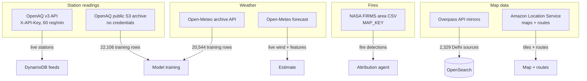

# Data collection

How every byte of real data enters the system, and how we verified each source.

## Verification rule

Before using any external API we read its current official documentation and confirmed endpoints, auth, schemas and rate limits. Findings are recorded in `docs/DATA_SOURCES.md` with the verified date. Where memory conflicted with the docs, the docs won.

## Source map



## Station readings (OpenAQ)

- **Live**: `GET /v3/locations?coordinates=<lat>,<lon>&radius=<m>` then `GET /v3/locations/{id}/latest`, authenticated with `X-API-Key`.
- **Training**: the public archive bucket `https://openaq-data-archive.s3.amazonaws.com/records/csv.gz/locationid=<id>/year=<y>/month=<m>/location-<id>-<yyyymmdd>.csv.gz` — no credentials required. Delhi station location ids were discovered by **probing** the archive (IDs 2,000–960,000) and filtering by coordinates; that probe found the real Delhi, Chennai, Hyderabad and Mumbai stations.
- **Without a key** the client raises `NotConfiguredError`; `/v1/status` shows the feed as unavailable. No fabricated fallback ever.

Client: `backend/src/dhuan/ingest/openaq.py`.

## Weather (Open-Meteo)

- Forecast: `https://api.open-meteo.com/v1/forecast?hourly=wind_speed_10m,wind_direction_10m,…&timezone=Asia/Kolkata&wind_speed_unit=ms`
- History: `https://archive-api.open-meteo.com/v1/archive` (the `archive.` hostname is **not** reachable from all networks; `archive-api.` is the correct host).
- Wind direction is the meteorological "wind FROM" bearing — exactly what the upwind cone expects.
- Hours with missing wind are dropped, never interpolated into existence.

Client: `backend/src/dhuan/ingest/weather.py`.

## Fires (NASA FIRMS)

- `GET /api/area/csv/{MAP_KEY}/{SOURCE}/{west,south,east,north}/{day_range}` with `SOURCE=VIIRS_SNPP_NRT`, `day_range` 1–5.
- The tool returns an explicit **unavailable** result when no `MAP_KEY` is configured; the agent then reports the fire feed as missing evidence rather than guessing.
- 5,000 transactions per 10 minutes per key; our bbox query is 1 call per pipeline run.

Client: `backend/src/dhuan/ingest/firms.py`.

## Map sources (OpenStreetMap via Overpass)

- Query: closed ways with `landuse=landfill|industrial|construction` plus `node[highway=traffic_signals]` within a bbox, `out geom`.
- Mirrors in order: `overpass-api.de`, `overpass.private.coffee`, `overpass.kumi.systems`. **Regional mirrors (osm.ch, osm.jp) serve national extracts only** — they return zero elements for Delhi; we learned this the hard way and only use global mirrors.
- A **contact User-Agent is mandatory**: generic UAs get HTTP 500/504 from the mirrors.
- ODbL 1.0 attribution is carried on every source document and shown in the UI footer.

Client: `backend/src/dhuan/ingest/osm.py`.

## CPCB AQI breakpoints

Fetched from the official CPCB document (`cpcb.nic.in/displaypdf.php?…About_AQI.pdf`), the table extracted with pypdf, and implemented as a versioned table (`CPCB_TABLE_VERSION = "2014-11-24h-breaks"`) in `backend/src/dhuan/model/cpcb.py`, with tests pinning the documented examples (31→51, 45→75, 60→100).

## Reproducibility

```bash
uv run python scripts/fetch_training_data.py     # stations + weather → data/training_snapshot.json
uv run python scripts/fetch_static_features.py   # OSM per-station context
uv run python scripts/fetch_boundary.py          # NCR boundary GeoJSON
```

Each script writes a `provenance` block next to its data (source, fetch time, query, snapshot hash).
