# Deployment

What is verified, how the pipeline works, and what still needs a real deploy.

## CI/CD flow

```mermaid
flowchart LR
    PR[Pull request] --> CI[CI: 14 jobs]
    CI -->|all green| MERGE[Merge to main]
    MERGE --> STAGING[Deploy staging<br/>OIDC role]
    STAGING --> SMOKE[scripts/smoke.py]
    SMOKE --> WEB[Frontend to S3<br/>CloudFront invalidation]
    WEB --> E2E[Playwright smoke]
    E2E --> TAG[Version tag v*]
    TAG --> APPROVAL[GitHub Environment<br/>manual approval]
    APPROVAL --> PROD[Deploy prod<br/>canary 10%]
    PROD --> REPORT[Summary: deployed URL]
```



## Verification matrix (honest)

| Check | Status | Evidence |
|---|---|---|
| `cfn-lint infra/template.yaml` | **Verified locally — zero findings** | cfn-lint 1.57.2 |
| ASL JSON validity | **Verified locally** | `json.load` in CI job |
| Backend tests (unit/model/agent/contract) | **Verified locally** | 230 tests, 84.65% coverage |
| Integration tests (OpenSearch + LocalStack) | **Verified locally** | docker compose test stack |
| Frontend tests + e2e + axe + Lighthouse | **Verified locally** | 80 Playwright tests, budget job in CI |
| `sam build --use-container` | **NOT verified locally** (no Docker image build of the Lambda layer run here) | run in CI before staging |
| `sam deploy` to staging | **NOT verified** — no AWS credentials in the build environment | requires `AWS_DEPLOY_ROLE_ARN` OIDC role |
| Real smoke test against staging | **NOT verified** | `scripts/smoke.py --env staging` |

**Nothing about a real AWS deployment is claimed.** Everything above the line passed on this machine; everything below requires credentials and runs in the CD pipeline.

## Rollback

- The API uses a Lambda alias (`live`) with `DeploymentPreference: Canary10Percent5Minutes` and an automatic rollback on the API error alarm.
- Manual rollback: `sam deploy` the previous tag, or `aws lambda update-alias --function-version <n>`.
- Frontend: redeploy the previous `dist` from S3 (or `git revert` + CD rerun).

## Environments

| Env | Trigger | Secrets needed |
|---|---|---|
| staging | push to `main` | `AWS_DEPLOY_ROLE_ARN`, `BEDROCK_MODEL_ID` |
| production | tag `v*` + approval | same, scoped to the prod role |

## Teardown

```bash
scripts/teardown.sh          # deletes the stack, buckets and topic
```
