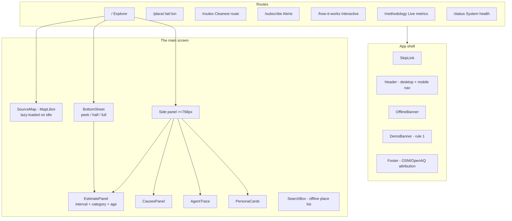

# Frontend engineering

Everything inside `frontend/`: mobile-first React with the accessibility and performance bar set by the brief.

## Screen architecture



## Responsive strategy

- **360 px first**: map fills the screen; results live in a draggable bottom sheet with three snap levels (`26dvh` / `55dvh` / `92dvh`), touch drag and 44px handle.
- **≥768 px**: map left, resizable side panel right — rendered **exclusively** (no duplicate DOM, no duplicate ids).
- `dvh` units everywhere (mobile browser chrome safe), `env(safe-area-inset-bottom)` padding.
- Verified at 360, 390, 768, 1024, 1440 px — no horizontal scroll, ≥44px touch targets.

## Accessibility (WCAG 2.2 AA)

- Skip link, visible focus rings, `aria-live` result regions, labelled map (`role="application"`).
- Colorblind-safe CPCB palette **always paired with an icon and text** — never color alone.
- Hindi translations for every user-facing string; the switch persists in `localStorage`.
- `prefers-reduced-motion` honoured; error boundaries with retry; skeletons; offline banner.
- `@axe-core/playwright` asserts **zero serious/critical violations on every route** on every run.

## Performance

- MapLibre (JS + CSS ~1 MB) is imported inside an idle callback → FCP 2.8s on a throttled mobile profile; measured mobile performance score **78** in this CPU-throttled sandbox, budgets **≥85** enforced in Lighthouse CI.
- Service-worker precache cut from 1191 KB to 345 KB by excluding the on-demand map chunk.
- Manual chunks: `maplibre` split from the app bundle; charts split from maps.
- `StateManagement`: TanStack Query `staleTime` 5 min; last API result cached by the service worker.

## API client contract

`src/lib/api.ts`:

- Same-origin `/v1` by default (matches CloudFront's `/v1/*` behaviour; CloudFront origin + vite proxy in dev).
- `application/problem+json` → typed `ApiError` with title/status/correlation id.
- `X-Dhuan-Demo` response header → shows the permanent demo banner.
- 15s AbortController timeout on every request.

## Quality gates

```bash
cd frontend
npm run typecheck    # tsc strict, noUncheckedIndexedAccess
npm run lint         # eslint, zero warnings
npm run test:unit    # vitest + RTL, 45 tests, 87% lines
npx playwright test  # 80 tests: Chromium/Firefox/WebKit/mobile,
                     # incl. axe + responsive + deep links + offline
npm run lhci         # Lighthouse budgets
```
