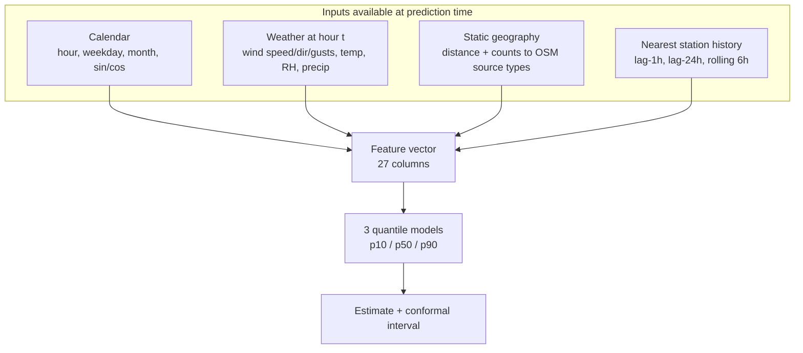

# The model

Full method, real metrics and honest limits. The canonical, generated version of this document lives in `docs/MODEL_CARD.md` (produced by `model/evaluate.py` + `scripts/generate_model_card.py`); this file explains the reasoning behind it.

## What it predicts

Hourly PM2.5 (µg/m³) at any point in Delhi-NCR, with an 80% interval.

## Training data (real, not synthetic)

| Source | What | Auth | Verified |
|---|---|---|---|
| OpenAQ public S3 archive | 22,106 hourly station rows across Delhi, Chennai, Hyderabad | none | archive buckets fetched live during the build |
| Open-Meteo archive API | 20,544 hourly weather rows at the same stations | none | HTTP 200, schema checked |
| OpenStreetMap (Overpass) | 2,329 real Delhi source geometries (landfills, industry, construction, junctions) | none | fetched live, mirrors documented |

The snapshot sha256 (`95a1ef3bb…`) is recorded in `metrics.json`, so `make train` is reproducible.

## Features



**Leakage policy** (enforced by tests in `tests/model/`): no feature may see the target station's own current reading. The station-history features use only observations **strictly before** the target hour. A test builds a two-row synthetic snapshot and asserts the second row's `station_lag1` is the first hour's value.

## Validation protocol

1. **Temporal holdout** — train before 2023-11-01, test on the final two months.
2. **Leave-one-station-out (LOSO)** — each station's location is never in training; the harshest test of transfer to a new city.
3. **Baselines** — global mean, per-station climatology, and persistence (lag-1h of the nearest station).

## The honest result

| Metric | Model | Best baseline (persistence) |
|---|---|---|
| MAE | 26.1 µg/m³ | 24.9 µg/m³ |
| RMSE | 59.8 µg/m³ | 73.0 µg/m³ |
| R² | 0.627 | 0.445 |
| 80% coverage | 0.800 (conformal) | n/a |

The model does **not** beat persistence on MAE. The brief's rule applies: the better option ships, and the API labels which one produced each number (`served_by`). Near a station the estimate is the station's persistence value; away from stations the model provides the number, with its measured error stated.

LOSO errors are large (mean MAE 131.6 µg/m³) — the model does **not** transfer to a new city without local training data. That is stated in the model card, the UI and the limitations section.

## How to reproduce

```bash
make train       # trains, writes models/model.pkl + models/metrics.json
make evaluate    # regenerates docs/MODEL_CARD.md from metrics.json
```
