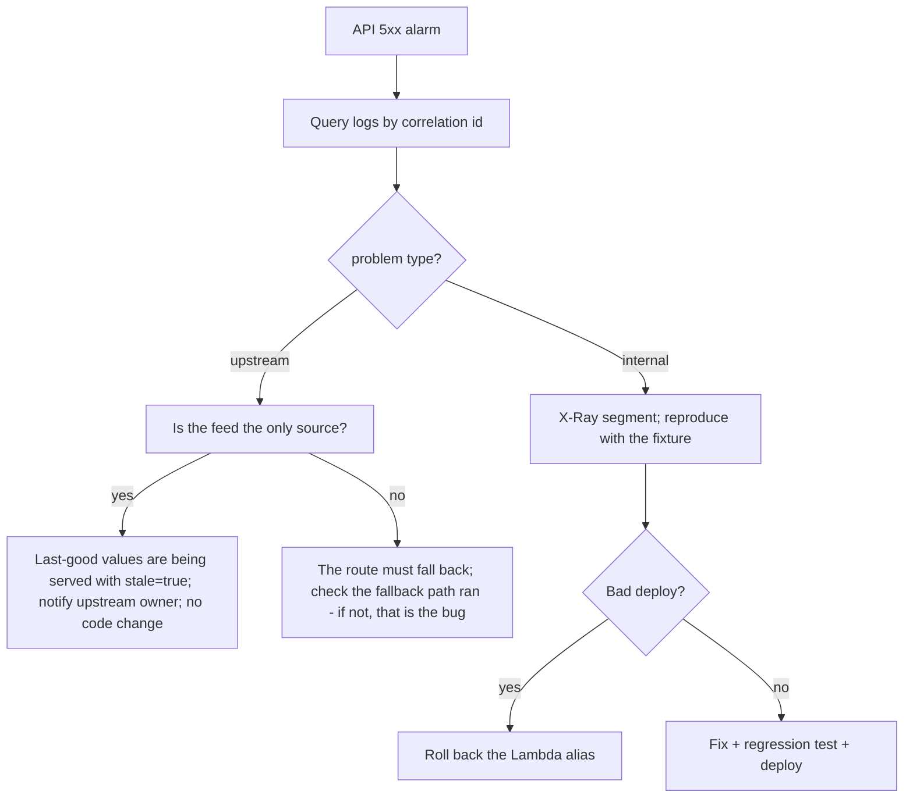
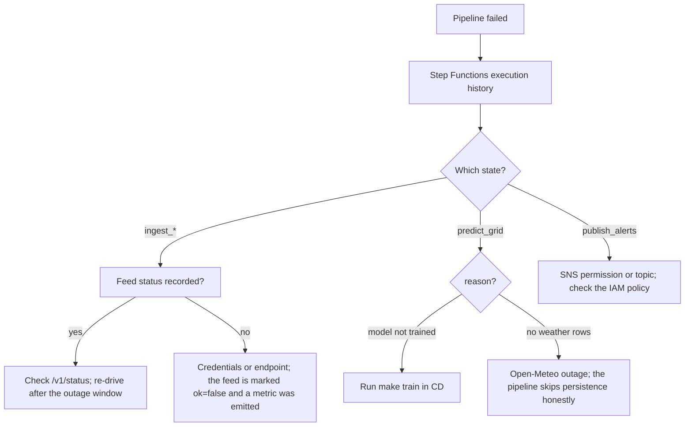

# Runbook

Alarm → diagnosis → fix. Keep this current: when an incident teaches a new path, add it here (rule 9, `update-docs` skill).

## Alarm map

| Alarm | Namespace/metric | Means |
|---|---|---|
| `dhuan-api-errors` | `AWS/Lambda Errors` | API is throwing |
| `dhuan-pipeline-dlq-depth` | `AWS/SQS ApproximateNumberOfMessagesVisible` | failed executions landed in the DLQ |
| (to add) pipeline failures | `PipelineFailures` metric in `DhuanDetective/Local` | a stage exhausted retries |
| (to add) stale feeds | per-feed `FeedXFailed` | an upstream is down |

## API 5xx decision flow

## Pipeline failure decision flow

## Stale feeds

Symptoms: `/v1/status` shows `ok=false`; estimates carry `stale=true` with large `data_age_seconds`.

1. Identify the feed from `/v1/status`.
2. Check its credential (`OPENAQ_API_KEY`, `FIRMS_MAP_KEY`) in SSM.
3. Check upstream status pages (OpenAQ, Open-Meteo, FIRMS, Overpass mirrors).
4. If it is a credential, rotate in SSM — never in the repo.

## DLQ

1. Read the message body → the execution error.
2. Fix the cause.
3. Re-drive: start that execution manually with the same input.
4. Confirm the depth alarm clears; purge once redriven.

## Common quick fixes

| Symptom | Fix |
|---|---|
| `/v1/estimate` 503 with "OpenAQ not configured" | set `OPENAQ_API_KEY` in SSM Parameter Store `/dhuan/openaq-api-key` |
| Sources empty in UI | OpenSearch index missing → `make seed-sources` |
| Map blank | tiles blocked/offline → the map error state explains it; estimate still works |
