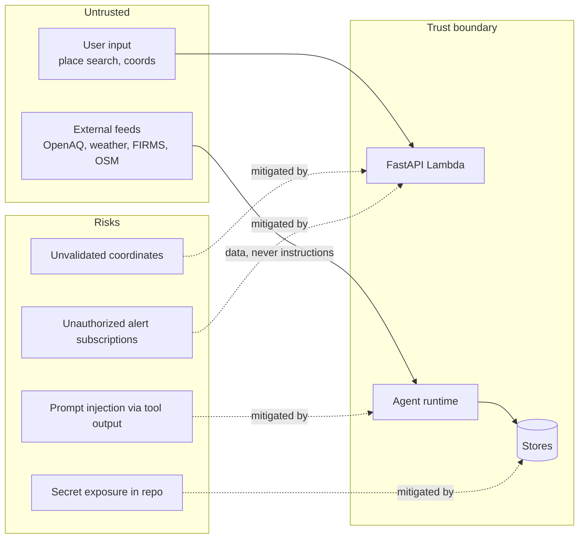

# Security

Threat model, IAM posture, and privacy.

## Threat model (data flow)



| Risk | Mitigation | Where |
|---|---|---|
| Prompt injection through a tool result (e.g. a maliciously-named OSM source) | Tool output wrapped as DATA; instruction markers redacted by `sanitize_output_text`; tool-call and token budgets; test scenario asserts the injection never reaches outputs | `backend/src/dhuan/agents/` |
| Invalid coordinates | Pydantic bounds + the Delhi-NCR coverage polygon (422 problem+json) | `api/routers/*` |
| Secrets in the repo | `.env.example` holds names only; gitleaks in pre-commit and CI; runtime values from SSM/Secrets Manager | `.pre-commit-config.yaml`, CI |
| Alert subscription abuse | Idempotent by (email, locality); SNS email confirmation with a stored token; unsubscribe removes the SNS subscription | `api/routers/subscriptions.py` |
| Enumeration of subscriptions | Deterministic sha256 id per (email, locality); confirm requires the emailed token | same |
| Abusive traffic | API Gateway usage plan burst/rate limits; stricter limits on `/v1/explain`; WAF behind a flag | `infra/template.yaml` |
| Supply chain | Dependabot, pip-audit, npm audit, Trivy image scans, CodeQL | CI |

## IAM

Least privilege per function:

- API Lambda: `dynamodb:*` on its three tables (+ the locality GSI), `s3:Get/Put` on one bucket, `bedrock:InvokeModel`, `sns:Publish` on one topic, `ssm:GetParameter` under `/dhuan/*`, X-Ray write.
- Pipeline Lambda: DynamoDB CRUD on feeds/estimates, `sns:Publish`, cloudwatch.
- StateMachine role: `lambda:InvokeFunction` for the pipeline function only.
- Deployment: GitHub OIDC role, no long-lived keys.

## Privacy

- We store only what the feature needs: subscription email, locality name, lat/lon, threshold, and hysteresis state.
- Browser geolocation is requested explicitly and never stored server-side.
- No analytics, no ad-tech, no third-party trackers.
- The PWA caches the shell and the last result locally, only.

## Secret handling

```bash
# put (never commit)
aws ssm put-parameter --name /dhuan/openaq-api-key --type SecureString --value "..."
aws ssm put-parameter --name /dhuan/firms-map-key --type SecureString --value "..."
```

The application reads names from the environment; values come from SSM at deploy time.
