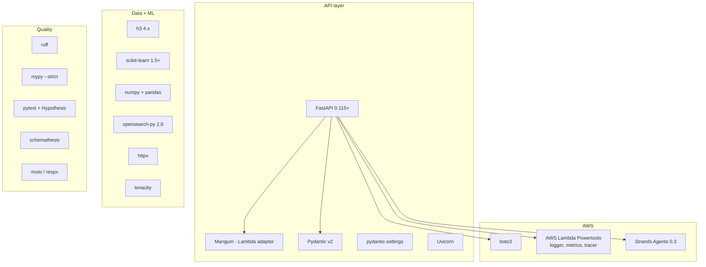
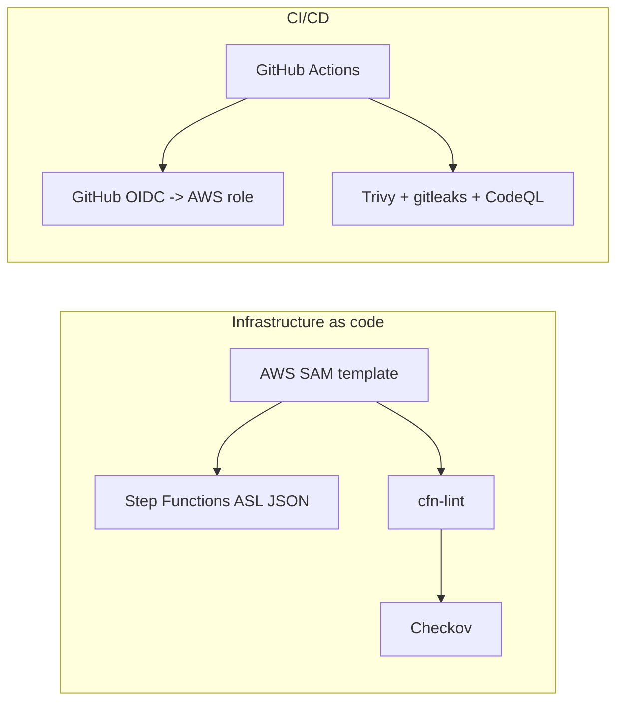

# Technology stack

Every component, the version we pin, and why it was chosen.

## Backend — Python 3.12



| Component | Version | Why this one |
|---|---|---|
| Python | 3.12 | Modern generics, `asyncio` maturity, Lambda-supported |
| Package manager | `uv` | Fast, reproducible lockfile, no pip resolver pain |
| FastAPI | 0.115+ | Typed routes, automatic OpenAPI, dependency injection |
| Mangum | 0.19+ | ASGI→Lambda adapter for the API container |
| Pydantic v2 | 2.7+ | Performance + strict validation of every response |
| httpx | 0.27+ | Async client with explicit timeouts and connection pooling |
| tenacity | 8.3+ | Retries with exponential backoff + jitter (`wait_exponential_jitter`) |
| h3 | 4.1+ | The hexagonal grid system (res 8 ≈ 0.74 km²) |
| scikit-learn | 1.5+ | `HistGradientBoostingRegressor` with quantile loss |
| numpy / pandas | latest pinned | Feature matrices and joins |
| opensearch-py | 2.8+ | Geo queries (`geo_distance`) and bulk indexing |
| boto3 | 1.34+ | Every AWS service |
| aws-lambda-powertools | 2.40+ | Structured logging, EMF metrics, X-Ray tracing |
| strands-agents | 0.3.0 | The agent framework (Bedrock model via `BEDROCK_MODEL_ID`) |
| pytest + Hypothesis | 8.x / 6.x | Unit, integration, contract; property tests for geo math |
| schemathesis | 3.35+ | OpenAPI contract fuzzing |
| ruff / mypy --strict | latest | Lint (50+ rules) and strict typing |

## Frontend — React 18 + TypeScript 5

```mermaid
flowchart TB
    subgraph App[Application]
        R[React 18 + StrictMode]
        TS[TypeScript 5 strict]
        RR[React Router 6]
        TQ[TanStack Query 5]
    end
    subgraph UI[UI]
        TW[TailwindCSS 3]
        ML[MapLibre GL 4]
        RC[Recharts - 24h view]
        I18[react-i18next<br/>English + Hindi]
    end
    subgraph Build[Build + quality]
        V[Vite 5]
        PWA[vite-plugin-pwa]
        VT[Vitest 2]
        PW[Playwright]
        AX[@axe-core/playwright]
        LH[Lighthouse CI]
    end
    R --> TS
    R --> RR
    R --> TQ
    R --> TW
    R --> I18
    TW --> ML
    V --> PWA
    VT --> PW
    PW --> AX
    PW --> LH
```

| Component | Version | Why this one |
|---|---|---|
| React | 18.3 | StrictMode, concurrent features, mature ecosystem |
| TypeScript | 5.6 | `strict` + `noUncheckedIndexedAccess` for honest null-safety |
| Vite | 5.4 | Fast HMR, native ESM, easy manual chunk splitting |
| TailwindCSS | 3.4 | Mobile-first utilities, dark mode via `prefers-color-scheme` |
| MapLibre GL | 4.7 | Open map renderer; works with Amazon Location tiles and OSM |
| TanStack Query | 5.59 | Caching, retries, background refetch for the estimate panel |
| react-i18next | 15 | EN/HI translations, persisted language switch |
| Vitest + RTL | 2.x | Component tests with jsdom |
| Playwright | 1.48 | Chromium/Firefox/WebKit + mobile viewport, real pointer events |
| @axe-core/playwright | 4.10 | Automated WCAG 2.2 AA checks on every route |
| Lighthouse CI | 13 | Performance ≥ 85 / a11y ≥ 95 / best-practices ≥ 95 / SEO ≥ 90 on mobile |
| vite-plugin-pwa | 0.20 | Service worker: app shell + last-result cache |

## Infrastructure



| Component | Version | Why this one |
|---|---|---|
| AWS SAM | latest | CloudFormation extension built for Lambda + containers |
| Step Functions ASL | JSON | The pipeline definition, retries and catch blocks |
| cfn-lint | 1.57 | Template validation (currently **zero findings**) |
| Checkov | latest | IaC security scanning |
| GitHub Actions | — | Every PR: lint, types, tests, contract, model, agent, e2e, axe, Lighthouse, IaC, security |
| GitHub OIDC | — | No long-lived AWS keys in CI |

## Deliberate non-choices

- **No LightGBM/XGBoost** — sklearn's histogram gradient boosting is fast enough at our scale and keeps one fewer native dependency in the Lambda image.
- **TypeScript for the frontend only** — Python stays Python (no mixed-language tooling).
- **No React Native / Flutter** — a PWA reaches the same phones with one codebase and offline support.
- **No Terraform** — SAM gives us Lambda container deployments and canary rollbacks in one file.

## Version pinning

- Python: exact 3.12 (`.python-version` semantics via `uv`).
- Node: `engines.node >= 20` in `package.json`.
- The Docker base image is pinned by digest in `backend/Dockerfile`.
- `uv.lock` and `package-lock.json` are committed; Dependabot opens weekly PRs.
