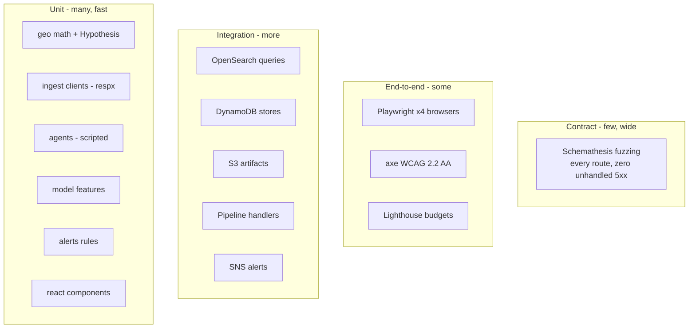

# Testing

The test pyramid, how to run each layer, and how failures are triaged.

## Pyramid

## Layers

| Layer | Tooling | How to run | Requirements |
|---|---|---|---|
| Backend unit | pytest + Hypothesis | `cd backend && uv run pytest tests/unit -q` | none |
| Model | pytest | `make train && uv run pytest tests/model -q` | `models/metrics.json` |
| Agent evals | pytest | `uv run pytest tests/agent_evals -q` | none (deterministic) |
| Integration | pytest + containers | `docker compose -f docker/docker-compose.test.yml up -d --wait && uv run pytest tests/integration -q` | Docker |
| Contract | Schemathesis | `uv run pytest tests/contract -q` | none |
| Frontend unit | Vitest + RTL | `cd frontend && npm run test:unit` | none |
| E2E | Playwright | `npx playwright test` | preview build + browsers |
| Coverage | coverage-v8 / pytest-cov | see vitest config / `--cov=src/dhuan` | thresholds enforced |

## Measured numbers (this repo, today)

- Backend: **230 passing** (1 skipped without a trained artifact), **84.65%** line coverage; `fail_under = 84` with the rationale in `backend/pyproject.toml` (remaining lines are live-AWS paths).
- Frontend: **45 unit tests**, 87% lines, 76% branches.
- Playwright: **80 tests** (Chromium, Firefox, WebKit, mobile-chrome) including axe and responsive checks.

## Triage guide

| Symptom | Likely culprit | First look |
|---|---|---|
| `Connection refused` on 9201/4567 | containers not up | `docker compose -f docker/docker-compose.test.yml up -d --wait` |
| `expiresIn` KeyError from botocore | machine AWS login token leaking into tests | conftest isolates `HOME` and resets `boto3.DEFAULT_SESSION` |
| Coverage below threshold | new untested module | `--cov-report=term-missing` |
| Contract 5xx | route raising an untyped error | the failure body shows the route |

## When adding a change

1. Unit tests for the logic you added (fast, hermetic).
2. Integration test if it touches DynamoDB/OpenSearch/S3/SNS.
3. Contract coverage is automatic once the route exists.
4. A Playwright journey if the UI behaviour changed (and an axe run covers every route already).
