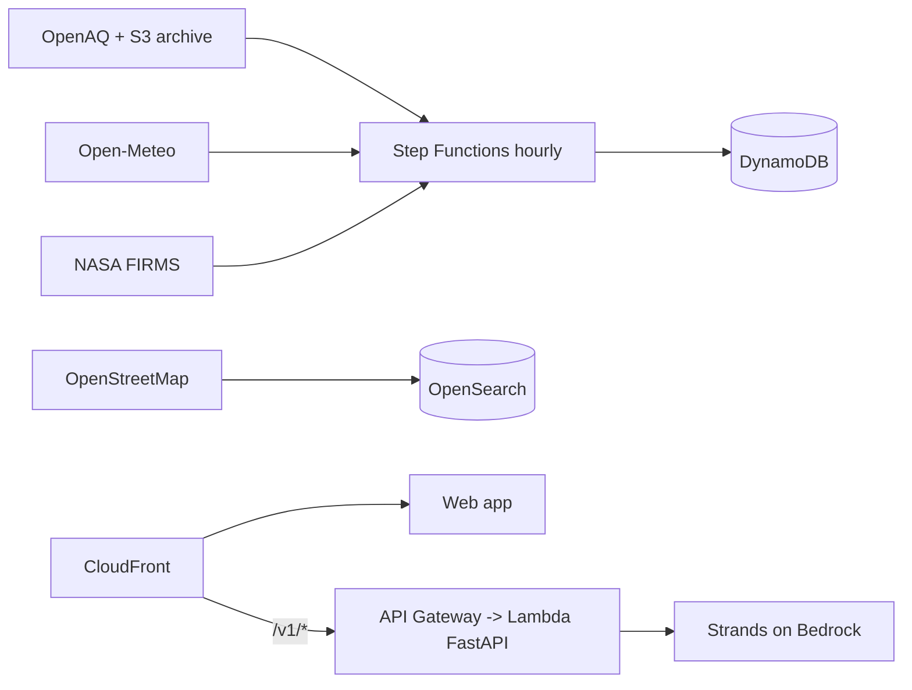

# Dhuan Detective

**Why is the air bad on my street right now, and what should I do?**

Street-level PM2.5 estimation, upwind source attribution and persona advice for Delhi-NCR.

## Product goals

Dhuan Detective exists to answer one question: **why is the air bad on my street
right now, and what should I do about it?** Four pillars, in the order a person
meets them:

| # | Pillar | What the user gets | Status |
|---|---|---|---|
| 1 | **Estimate** | Street-level PM2.5 for *any* coordinate, including places with no monitor, with a calibrated 80% interval | Live. Gradient-boosted trees on the persistence-anchored residual; MAE 11.12 µg/m³ on future hours and **10.58 on stations it has never seen** |
| 2 | **Attribute** | The likely upwind sources — landfill, industry, construction, junctions — with distance, bearing and influence | Live. OpenStreetMap geo search, 2,329 real Delhi geometries |
| 3 | **Explain** | A plain-language account that shows its work: the model, the arithmetic, every parameter that moved the number | Live. Tool-call trace + per-parameter contributions in µg/m³. Bedrock synthesis where the account allows it, deterministic backend otherwise, always labelled |
| 4 | **Act** | Persona advice, threshold alerts by email, and which way to go is cleaner | Live. Advice, real SMTP alerts with one-click unsubscribe, and a real road-network route comparison ranked by exposure |

### The rules the product holds itself to

1. **Estimate, never fabricate.** Every number says it is an estimate, carries its
   interval, its data age, and which component produced it (`model` or
   `nearest-station`). When an upstream feed is missing the API refuses rather
   than guessing.
2. **Show the working.** The estimate response carries the station it anchored
   on, the model's correction, and a per-parameter contribution. The model card
   is served from `metrics.json` at `GET /v1/model` — never hand-written.
3. **Report the weak case.** Unseen-station MAE is printed next to future-hour
   MAE on the model card and in the UI. A 3-station model generalised to nowhere
   (MAE 129.9); the 73-station model reaches 10.6. Both numbers are public.
4. **Credit and verify.** Station links go to the official CPCB dashboard; the
   footer credits OpenAQ (CC BY 4.0), OpenStreetMap (ODbL) and Open-Meteo.

### Where the data comes from

| Input | Source | Key needed |
|---|---|---|
| Station PM2.5 | OpenAQ public archive (56,003 locations enumerated, 77 in Delhi-NCR) | no |
| Weather | Open-Meteo forecast + archive | no |
| Roads | OSRM public demo server | no |
| Pollution sources | OpenStreetMap via Overpass | no |
| Fires | NASA FIRMS | optional |

The whole training set is extracted credential-free by
`scripts/fetch_recent_training_data.py` and committed gzipped.

## Start here

| Read | If you want |
|---|---|
| [README](https://github.com/FiscalMindset/aqi) | The whole pitch and the quickstart |
| [Rules](RULES.md) | The engineering rules this repo enforces |
| [Architecture](ARCHITECTURE.md) | How the system fits together (flow, sequence, state, ER) |
| [AWS](AWS.md) | Every AWS service and the real job it does |
| [Technology stack](TECHNOLOGY_STACK.md) | Every dependency and why it was chosen |

## Engineering

- [Backend](BACKEND.md) · [Frontend](FRONTEND.md) · [Algorithms](ALGORITHM.md)
- [Model method](MODEL.md) · [Model card](MODEL_CARD.md) · [Gradient boosting](GRADIENT_BOOSTING.md)
- [Agents design](AGENTS_DESIGN.md) · [API reference](API.md)

## Data

- [Data sources](DATA_SOURCES.md) — licences, rate limits, verified dates
- [Data collection](DATA_COLLECTION.md) — how real data is fetched

## Quality and operations

- [Testing](TESTING.md) · [Security](SECURITY.md)
- [Deployment](DEPLOYMENT.md) · [Runbook](RUNBOOK.md) · [Cost](COST.md) · [Contributing](CONTRIBUTING.md)

## Demo and write-up

- [Demo script](DEMO.md) · [Blog draft](BLOG.md)

## Decisions

[8 ADRs](adr/index.md) — H3 resolution, conformal interval, the model-vs-baseline
serve rule, the agent backend abstraction, the OpenAPI pin, the coverage
threshold, exclusive panel rendering, and the demo-data banner.
