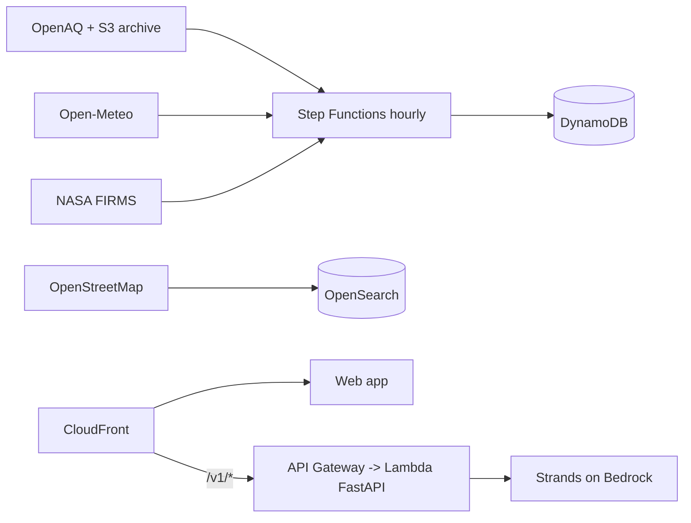

# Dhuan Detective

**Why is the air bad on my street right now, and what should I do?**

Street-level PM2.5 estimation, upwind source attribution and persona advice for Delhi-NCR.

## Start here

| Read | If you want |
|---|---|
| [README](https://github.com/FiscalMindset/aqi) | The whole pitch and the quickstart |
| [Rules](RULES.md) | The engineering rules this repo enforces |
| [Architecture](ARCHITECTURE.md) | How the system fits together (flow, sequence, state, ER) |
| [AWS](AWS.md) | Every AWS service and the real job it does |
| [Technology stack](TECHNOLOGY_STACK.md) | Every dependency and why it was chosen |

## Engineering

- [Backend](BACKEND.md) · [Frontend](FRONTEND.md) · [Algorithms](ALGORITHM.md)
- [Model method](MODEL.md) · [Model card](MODEL_CARD.md) · [Gradient boosting](GRADIENT_BOOSTING.md)
- [Agents design](AGENTS_DESIGN.md) · [API reference](API.md)

## Data

- [Data sources](DATA_SOURCES.md) — licences, rate limits, verified dates
- [Data collection](DATA_COLLECTION.md) — how real data is fetched

## Quality and operations

- [Testing](TESTING.md) · [Security](SECURITY.md)
- [Deployment](DEPLOYMENT.md) · [Runbook](RUNBOOK.md) · [Cost](COST.md) · [Contributing](CONTRIBUTING.md)

## Demo and write-up

- [Demo script](DEMO.md) · [Blog draft](BLOG.md)

## Decisions

[8 ADRs](adr/index.md) — H3 resolution, conformal interval, the model-vs-baseline
serve rule, the agent backend abstraction, the OpenAPI pin, the coverage
threshold, exclusive panel rendering, and the demo-data banner.
