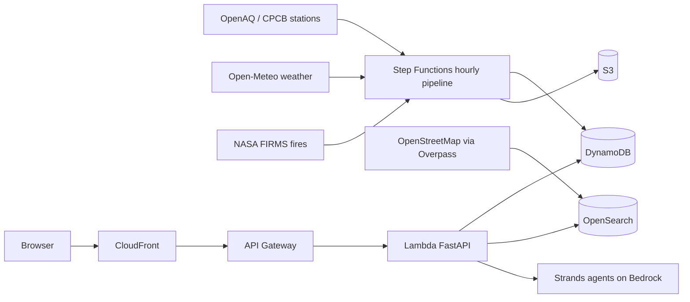

# explain.md — The complete story (interview-ready)

> Everything you need to explain Dhuan Detective: **what** we are making,
> **why**, **how** we solve it, **why AWS**, **how** we use AWS, and **how**
> we get real data. Written to be read out loud in an interview. Every claim
> here is backed by something in this repository.

---

## 1. The 30-second pitch

Delhi has one of the world's worst air pollution problems, but the information
a family actually needs — *"is it safe for my kid to play outside right now,
on my street?"* — does not exist in a usable form. Official CPCB stations are
few and sparse, so most neighbourhoods have no reading at all. And even where
a station exists, it tells you *the number*, not *the cause*.

**Dhuan Detective** answers: *"Why is the air bad on my street right now, and
what should I do?"* For any point in Delhi it:

1. Estimates street-level PM2.5 hourly with a validated model (nearest city
   block, H3 resolution 8), with an honest 80% uncertainty interval.
2. Finds the likely pollution sources **upwind** using geospatial search over
   an OpenStreetMap-derived database of landfills, construction sites,
   industrial zones and junctions.
3. Uses an AI agent (AWS Strands + Amazon Bedrock) to explain the likely
   causes — with every claim tied to a visible piece of evidence.
4. Gives tailored, conservative advice for parents, delivery riders and
   outdoor workers, plus alerts and a cleanest-route comparison.

The one-line differentiator: **it shows its work**. The agent's tool-call
trace is visible in the UI, every number has an uncertainty and a freshness
age, and we publish our model's real validation metrics — including how it
compares to a simple nearest-station baseline.

---

## 2. What problem, and why does it matter (the "why")

- **Measurement gap.** Delhi-NCR has on the order of ~40 official CPCB
  continuous monitoring stations for a metro of 30+ million people. Most
  localities have no official reading.
- **Causation gap.** "PM2.5 is 250" does not tell you whether to keep your
  child home, whether to take the longer commute, or whether tomorrow's
  stubble-burning smoke is the problem.
- **Trust gap.** Many AQI apps show a number with no provenance. During
  smog episodes people make real decisions (school runs, deliveries,
  outdoor work shifts). Accountability requires showing evidence and
  uncertainty.

Judging criteria we optimized for: a real problem, a small problem solved
well, something that actually works, and honest evidence.

---

## 3. How we solve it (the "how")

**Step 1 — Estimate.** A gradient-boosting model (scikit-learn
`HistGradientBoostingRegressor`, quantile loss) predicts hourly PM2.5 on every
H3 res-8 cell in Delhi-NCR. Features combine: nearest-station readings
(including upwind stations, explicitly *not* the target cell's own station at
prediction time), weather from Open-Meteo (wind speed/direction, temperature,
humidity, boundary-layer height), fire counts within radius (FIRMS), and
static spatial features (distance to major roads, landfills, industrial
zones). Three models produce the median and the 10th/90th percentiles — the
80% interval is calibrated and its empirical coverage is reported.

**Step 2 — Attribute.** OpenSearch holds ~every landfill, construction site,
industrial area and major road junction in Delhi-NCR from OSM, geo-indexed.
For a query cell we take the wind vector and run a radius + upwind-cone
query; each hit gets a transparent heuristic influence score
(type weight × size × distance decay × wind-speed conditioner). **This is a
heuristic, not a causal model** — and we say so in the UI.

**Step 3 — Explain.** A Strands agent with typed tools
(`get_air_and_wind`, `find_upwind_sources`, `get_recent_fires`,
`get_model_estimate`, `get_station_context`) returns a structured Pydantic
result. Every claim references an evidence id from a tool call **in the same
run**. A second advisory agent turns that into per-persona guidance. Guardrails
treat tool output as data (prompt-injection safe), cap tool calls/tokens, and
return low confidence when evidence is thin.

**Step 4 — Act.** Alerts when the estimate crosses your chosen category,
with hysteresis, quiet hours and dedupe; a cleanest-route comparison that
samples points along Location Service routes and ranks by exposure × time.

---

## 4. Why AWS — and what each service actually does

We are not "using AWS to host files". Each service does real work:

| AWS service | The real job |
|---|---|
| **Amazon Bedrock (Claude via Strands Agents SDK)** | The reasoning behind `/v1/explain`. Model id comes from env var; nothing hardcoded. |
| **Amazon OpenSearch** | Geo-indexed source database; radius and upwind-cone queries that make the attribution agent possible in milliseconds. |
| **AWS Step Functions** | The hourly pipeline: parallel ingest → validate/merge → predict → persist → alert, with retries, catch blocks and a DLQ. |
| **Amazon EventBridge** | Hourly pipeline schedule + monthly source refresh. |
| **Lambda + API Gateway** | The API itself: one container image, several handlers, stage throttling + usage plan. |
| **Amazon DynamoDB** | Estimates (with TTL), feed freshness, subscriptions. On-demand, point-in-time recovery. |
| **Amazon S3 + CloudFront** | Web app hosting, grid GeoJSON, model artifacts, raw data archive. |
| **Amazon SNS** | Alert fan-out to email subscribers with per-locality filter policies. |
| **Amazon Location Service** | Map tiles for MapLibre and the route alternatives behind the cleanest-route comparison. |
| **CloudWatch + X-Ray (via Lambda Powertools)** | Structured logs with correlation ids, metrics, dashboards, alarms, traces. |
| **SSM Parameter Store / Secrets Manager** | API keys and config; nothing secret in the repo. |

**Why this stack and not alternatives:** serverless+managed means a two-person
team can run a global-quality data pipeline with no servers to patch;
OpenSearch gives us geo queries no SQL store can do well; Step Functions gives
auditable, retryable orchestration for free; Bedrock gives frontier reasoning
without touching GPUs. The cost profile (documented in `docs/COST.md`) is
single-digit dollars per month at demo scale.

---

## 5. How we get the real data (this is the honest part)

| Source | What | Auth | How we verified it |
|---|---|---|---|
| **OpenAQ** (mirrors CPCB stations) | Ground-truth PM2.5 | API v3 needs `X-API-Key` (free signup); the **public archive bucket** `openaq-data-archive.s3.amazonaws.com` needs none | Fetched live archive rows for Delhi (location 8118 = "New Delhi", 28.6358, 77.2244) during the build; rate limits documented |
| **Open-Meteo** | Weather + air-quality reanalysis, historical and forecast | **No key** | Verified HTTP 200 from this network; hourly history confirmed |
| **NASA FIRMS** | Active fire detections (stubble burning, waste fires) | Free MAP_KEY | Endpoint + schema verified against docs |
| **OpenStreetMap / Overpass** | Landfills, construction, industry, junctions | None | Verified via POST query (mirrors documented; main endpoint rate-limits with retries) |
| **CPCB** | Official Indian AQI breakpoints | — | Breakpoints implemented as a versioned, cited table (no reliance on memory) |

**Training data = real.** We snapshot real OpenAQ station rows (hourly PM2.5,
with provenance recorded: query date, location ids, license CC BY 4.0) into
`fixtures/training_snapshot/`, join them with real Open-Meteo historical
weather and real fire counts, and train on that. The snapshot is recorded
data, clearly labelled — not invented numbers.

**DEMO_MODE** (off by default) may serve recorded responses for demos without
live upstreams; the UI shows a permanent, visible "Demo data" banner whenever
it is on.

---

## 6. Likely interview questions — and the honest answers

**Why not just show CPCB station readings?**
Because most Delhi localities are not within a meaningful distance of a
station. Our model's job is the space between stations — and we publish how
well it does that job versus the nearest-station baseline, so users can judge.

**How accurate is it?**
Real metrics from `model/evaluate.py` are published in `docs/MODEL_CARD.md`
— MAE, RMSE, R², bias and interval coverage, overall and by AQI band, with
leave-one-station-out and temporal holdout. We never quote a number we have
not computed. If the model is not better than the baseline, we say so.

**Isn't the "likely causes" list speculative?**
It is a transparent, documented heuristic for *ranking candidates* — not a
causal claim. The UI labels it "likely contributors" and shows the evidence
behind each item. That's the honest position: source attribution from public
data is inference, and we show our inference.

**Could a malicious data source prompt-inject the agent?**
Tool output is treated strictly as data, never instructions. Agent tool
results are wrapped as untrusted payloads, tool calls and tokens are capped,
timeouts enforced. We test it: `tests/agent_evals/` includes an injected
malicious string inside a source name and asserts the agent refuses to follow
it.

**Why is SMS not on by default?**
SMS in India requires sender-id/DLT registration; we document that and keep
SMS behind a feature flag. Email works now.

**What about privacy?**
We store only what the feature needs: subscription email + locality +
threshold. The browser geolocation is asked for explicitly and never stored.
No ad-tech, no tracking pixels.

**What would you do with six more months?**
1) Fuse CPCB direct feeds and low-cost sensors (PurpleAir) into the ground
truth, 2) add a forecast model with measured error vs the published
typical-diurnal fallback, 3) validated personal exposure studies with local
schools and worker groups.

**What's the weakest part?**
The attribution ranking is a heuristic; measurement density is low outside
central Delhi; the interval covers model error, not sensor error. All three
are stated in the model card and the UI.

---

## 7. Where the evidence lives in this repo

| Claim | Proof |
|---|---|
| Real data | `docs/DATA_SOURCES.md` (verified dates), `fixtures/training_snapshot/` provenance file |
| Model is real | `docs/MODEL_CARD.md` generated by `backend/src/dhuan/model/evaluate.py` |
| Honesty in UI | estimate always shows ± interval + data age + "Estimate, not a measurement" |
| Agent can't be hijacked | `backend/tests/agent_evals/` injection scenario |
| Nothing fake in prod code | CI job greps `src` for forbidden tokens (no stubs/TODOs/fake data) |
| It runs | `make dev` (Docker), `make test`, `make docs`, `scripts/smoke.py` |

*This file is a living document — updated as the build progresses.*
